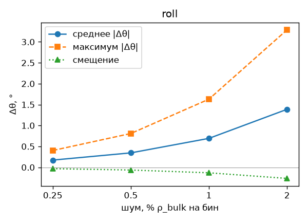
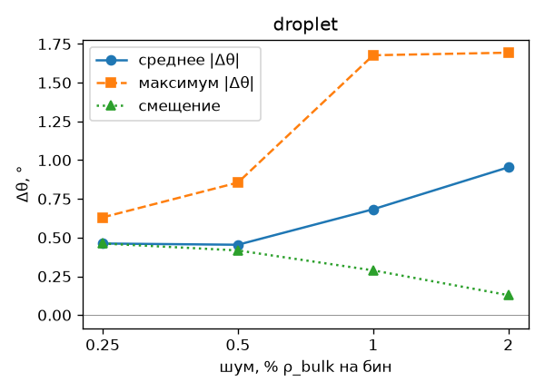
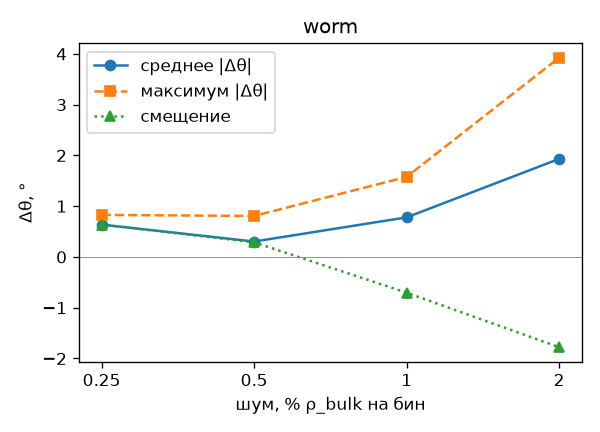
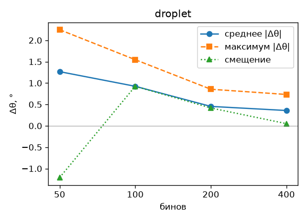
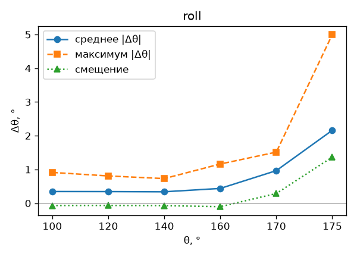

# Точность метода на синтетике
Сгенерировано `validation/run_accuracy.py`. Щель 8 × 16 нм, ρ_bulk = 30 нм⁻³, 10 зёрен шума на точку, фит — настройки по умолчанию (θ и δ свободны, φ из ∫ρ). Шум задан для 200 бинов и пересчитывается как √(бинов / 200). Δθ = восстановленный − истинный.

## Шум

### roll (истинные {'theta': 120.0, 'delta': 0.03, 'phi': 0.4})

| шум, % ρ_bulk на бин | среднее \|Δθ\|, ° | максимум \|Δθ\|, ° | смещение, ° |
|---|---|---|---|
| 0.25 | 0.17 | 0.40 | -0.03 |
| 0.5 | 0.35 | 0.81 | -0.07 |
| 1 | 0.69 | 1.63 | -0.13 |
| 2 | 1.39 | 3.29 | -0.27 |

### droplet (истинные {'theta': 130.0, 'delta': 0.03, 'phi': 0.05})

| шум, % ρ_bulk на бин | среднее \|Δθ\|, ° | максимум \|Δθ\|, ° | смещение, ° |
|---|---|---|---|
| 0.25 | 0.46 | 0.63 | +0.46 |
| 0.5 | 0.45 | 0.86 | +0.42 |
| 1 | 0.68 | 1.68 | +0.29 |
| 2 | 0.95 | 1.69 | +0.13 |

### worm (истинные {'theta': 130.0, 'delta': 0.03, 'phi': 0.1})

| шум, % ρ_bulk на бин | среднее \|Δθ\|, ° | максимум \|Δθ\|, ° | смещение, ° |
|---|---|---|---|
| 0.25 | 0.64 | 0.83 | +0.64 |
| 0.5 | 0.30 | 0.81 | +0.29 |
| 1 | 0.78 | 1.58 | -0.70 |
| 2 | 1.93 | 3.93 | -1.78 |

## Число бинов (шум 0.5 % при 200 бинах)

### roll (истинные {'theta': 120.0, 'delta': 0.03, 'phi': 0.4})

| бинов | среднее \|Δθ\|, ° | максимум \|Δθ\|, ° | смещение, ° |
|---|---|---|---|
| 50 | 0.81 | 1.24 | -0.81 |
| 100 | 0.30 | 0.69 | +0.05 |
| 200 | 0.35 | 0.81 | -0.07 |
| 400 | 0.31 | 0.81 | +0.09 |

### droplet (истинные {'theta': 130.0, 'delta': 0.03, 'phi': 0.05})

| бинов | среднее \|Δθ\|, ° | максимум \|Δθ\|, ° | смещение, ° |
|---|---|---|---|
| 50 | 1.27 | 2.25 | -1.21 |
| 100 | 0.92 | 1.55 | +0.92 |
| 200 | 0.45 | 0.86 | +0.42 |
| 400 | 0.36 | 0.73 | +0.05 |

## Угол (шум 0.5 %): точность у 180° — O11

### roll (истинные {'theta': 120.0, 'delta': 0.03, 'phi': 0.4})

| θ, ° | среднее \|Δθ\|, ° | максимум \|Δθ\|, ° | смещение, ° |
|---|---|---|---|
| 100 | 0.35 | 0.91 | -0.07 |
| 120 | 0.35 | 0.81 | -0.07 |
| 140 | 0.34 | 0.73 | -0.07 |
| 160 | 0.44 | 1.16 | -0.10 |
| 170 | 0.97 | 1.51 | +0.29 |
| 175 | 2.16 | 5.00 | +1.37 |

### droplet (истинные {'theta': 130.0, 'delta': 0.03, 'phi': 0.05})

| θ, ° | среднее \|Δθ\|, ° | максимум \|Δθ\|, ° | смещение, ° |
|---|---|---|---|
| 100 | 0.33 | 0.65 | +0.30 |
| 120 | 0.39 | 0.75 | +0.35 |
| 140 | 0.54 | 0.98 | +0.48 |
| 160 | 3.51 | 17.73 | +3.21 |
| 170 | 5.79 | 10.00 | +4.02 |
| 175 | 5.43 | 11.62 | -2.18 |

### worm (истинные {'theta': 130.0, 'delta': 0.03, 'phi': 0.1})

| θ, ° | среднее \|Δθ\|, ° | максимум \|Δθ\|, ° | смещение, ° |
|---|---|---|---|
| 100 | 0.24 | 0.56 | +0.17 |
| 120 | 0.33 | 0.73 | +0.33 |
| 140 | 0.46 | 0.96 | +0.45 |
| 160 | 0.80 | 1.66 | +0.80 |
| 170 | 2.07 | 3.54 | +2.07 |
| 175 | 3.99 | 4.99 | +3.93 |

## Центрирование при ошибке положения стенок 5 % H — O3

### roll (истинные {'theta': 120.0, 'delta': 0.03, 'phi': 0.4})

| центрирование по | среднее \|Δθ\|, ° | максимум \|Δθ\|, ° | смещение, ° |
|---|---|---|---|
| поре | 3.03 | 5.00 | +2.28 |
| поре + shift | 0.44 | 1.76 | -0.41 |
| жидкости, δ известна | 1.31 | 2.19 | +1.31 |

### droplet (истинные {'theta': 130.0, 'delta': 0.03, 'phi': 0.05})

| центрирование по | среднее \|Δθ\|, ° | максимум \|Δθ\|, ° | смещение, ° |
|---|---|---|---|
| поре | 0.58 | 1.15 | +0.57 |
| поре + shift | 0.58 | 1.15 | +0.57 |
| жидкости, δ известна | 0.42 | 0.91 | +0.42 |

