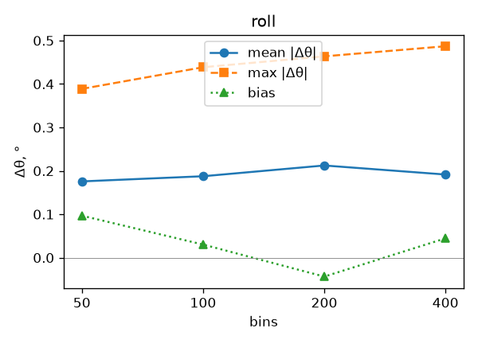
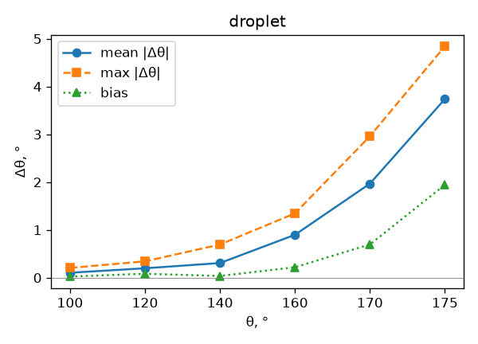
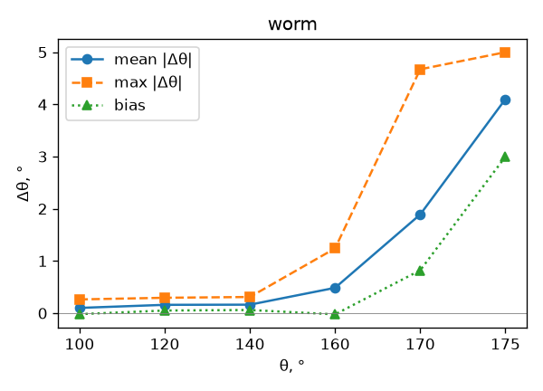
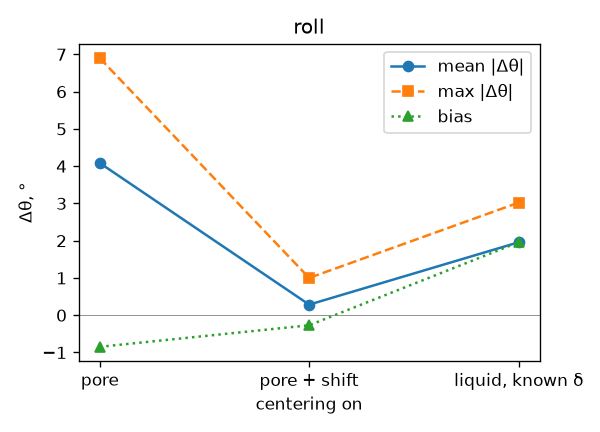
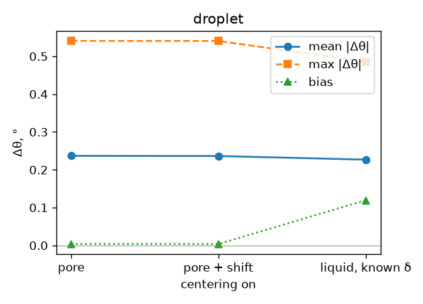

# Accuracy of the method on synthetic data
Generated by `validation/run_accuracy.py`. Slit 8 × 16 nm, ρ_bulk = 30 nm⁻³, 10 noise seeds per point, fit with the default settings (θ and δ free, φ from ∫ρ). The noise is given for 200 bins and scaled as √(bins / 200). Δθ = recovered − true.

## Noise

### roll (theta = 120, delta = 0.03, phi = 0.4)

| noise, % of ρ_bulk per bin | mean \|Δθ\|, ° | max \|Δθ\|, ° | bias, ° | at θ bound, of 10 |
|---|---|---|---|---|
| 0.25 | 0.11 | 0.23 | -0.02 | 0 |
| 0.5 | 0.21 | 0.46 | -0.04 | 0 |
| 1 | 0.42 | 0.93 | -0.09 | 0 |
| 2 | 0.85 | 1.86 | -0.18 | 0 |

### droplet (theta = 130, delta = 0.03, phi = 0.05)

| noise, % of ρ_bulk per bin | mean \|Δθ\|, ° | max \|Δθ\|, ° | bias, ° | at θ bound, of 10 |
|---|---|---|---|---|
| 0.25 | 0.09 | 0.19 | +0.04 | 0 |
| 0.5 | 0.19 | 0.38 | +0.06 | 0 |
| 1 | 0.37 | 0.76 | +0.12 | 0 |
| 2 | 0.63 | 1.32 | +0.24 | 0 |

### worm (theta = 130, delta = 0.03, phi = 0.1)

| noise, % of ρ_bulk per bin | mean \|Δθ\|, ° | max \|Δθ\|, ° | bias, ° | at θ bound, of 10 |
|---|---|---|---|---|
| 0.25 | 0.09 | 0.18 | +0.03 | 0 |
| 0.5 | 0.17 | 0.37 | +0.07 | 0 |
| 1 | 0.43 | 0.76 | +0.19 | 0 |
| 2 | 0.77 | 1.54 | +0.31 | 0 |

## Number of bins (noise 0.5 % at 200 bins)

### roll (theta = 120, delta = 0.03, phi = 0.4)

| bins | mean \|Δθ\|, ° | max \|Δθ\|, ° | bias, ° | at θ bound, of 10 |
|---|---|---|---|---|
| 50 | 0.18 | 0.39 | +0.10 | 0 |
| 100 | 0.19 | 0.44 | +0.03 | 0 |
| 200 | 0.21 | 0.46 | -0.04 | 0 |
| 400 | 0.19 | 0.49 | +0.04 | 0 |

### droplet (theta = 130, delta = 0.03, phi = 0.05)

| bins | mean \|Δθ\|, ° | max \|Δθ\|, ° | bias, ° | at θ bound, of 10 |
|---|---|---|---|---|
| 50 | 0.19 | 0.54 | +0.15 | 0 |
| 100 | 0.16 | 0.33 | -0.02 | 0 |
| 200 | 0.19 | 0.38 | +0.06 | 0 |
| 400 | 0.17 | 0.44 | +0.01 | 0 |

## Angle (noise 0.5 %): accuracy near 180°, O11

### roll (delta = 0.03, phi = 0.4)

| θ, ° | mean \|Δθ\|, ° | max \|Δθ\|, ° | bias, ° | at θ bound, of 10 |
|---|---|---|---|---|
| 100 | 0.22 | 0.58 | -0.05 | 0 |
| 120 | 0.21 | 0.46 | -0.04 | 0 |
| 140 | 0.21 | 0.46 | -0.06 | 0 |
| 160 | 0.25 | 0.58 | -0.10 | 0 |
| 170 | 0.39 | 0.72 | +0.04 | 0 |
| 175 | 0.93 | 2.79 | +0.36 | 0 |

### droplet (delta = 0.03, phi = 0.05)

| θ, ° | mean \|Δθ\|, ° | max \|Δθ\|, ° | bias, ° | at θ bound, of 10 |
|---|---|---|---|---|
| 100 | 0.10 | 0.21 | +0.02 | 0 |
| 120 | 0.20 | 0.34 | +0.08 | 0 |
| 140 | 0.31 | 0.69 | +0.04 | 0 |
| 160 | 0.90 | 1.35 | +0.22 | 0 |
| 170 | 1.97 | 2.96 | +0.70 | 0 |
| 175 | 3.74 | 4.84 | +1.94 | 0 |

### worm (delta = 0.03, phi = 0.1)

| θ, ° | mean \|Δθ\|, ° | max \|Δθ\|, ° | bias, ° | at θ bound, of 10 |
|---|---|---|---|---|
| 100 | 0.10 | 0.26 | -0.02 | 0 |
| 120 | 0.16 | 0.30 | +0.05 | 0 |
| 140 | 0.16 | 0.31 | +0.06 | 0 |
| 160 | 0.49 | 1.24 | -0.02 | 0 |
| 170 | 1.89 | 4.67 | +0.82 | 0 |
| 175 | 4.10 | 5.00 | +3.00 | 2 |

## Centering with the walls off by 5 % of H, O3

### roll (theta = 120, delta = 0.03, phi = 0.4)

| centering on | mean \|Δθ\|, ° | max \|Δθ\|, ° | bias, ° | at θ bound, of 10 |
|---|---|---|---|---|
| pore | 4.09 | 6.90 | -0.85 | 0 |
| pore + shift | 0.28 | 1.00 | -0.27 | 0 |
| liquid, known δ | 1.96 | 3.02 | +1.96 | 0 |

### droplet (theta = 130, delta = 0.03, phi = 0.05)

| centering on | mean \|Δθ\|, ° | max \|Δθ\|, ° | bias, ° | at θ bound, of 10 |
|---|---|---|---|---|
| pore | 0.24 | 0.54 | +0.00 | 0 |
| pore + shift | 0.24 | 0.54 | +0.00 | 0 |
| liquid, known δ | 0.23 | 0.49 | +0.12 | 0 |

